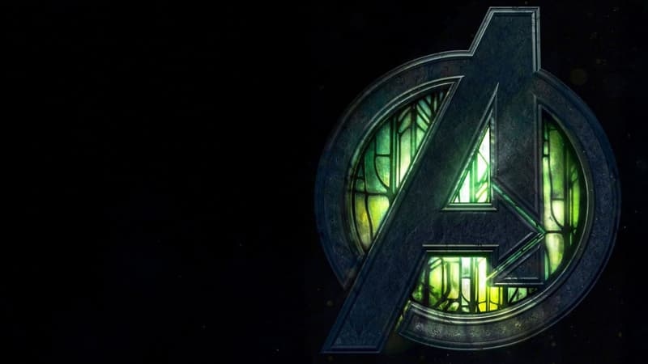

<div align="center">
  
</div>

<div align="center">

# Way to Doomsday

*A complete MCU watch-order tracker and countdown experience, built for the road to Avengers: Doomsday.*


</div>

<br/>

## Table of Contents

- [Overview](#overview)
- [Why This Exists](#why-this-exists)
- [How the Site Is Organized](#how-the-site-is-organized)
- [Features](#features)
- [Tech Stack](#tech-stack)
- [Project Structure](#project-structure)
- [Latest Doomsday Features](#latest-doomsday-features)
- [Local setup](#local-setup)
- [Deployment and privacy considerations](#deployment-and-privacy-considerations)
- [Contributing, help and rights](#contributing-help-and-rights)
- [Content & Attribution](#content--attribution)

<br/>

## Overview

Way to Doomsday is a fan-built companion site for tracking every Marvel Cinematic Universe release — every film and every series — in a single, continuous chronology leading up to *Avengers: Doomsday*. It pairs a live countdown to the film's theatrical release with an interactive timeline, a phase-by-phase breakdown, and a character-focused spotlight carousel, giving viewers one place to plan or revisit their watch order before the film premieres.

Rather than treating the MCU as a list of release dates, the site treats it as what it actually is: a single ongoing story spread across dozens of entries, several media formats, and more than fifteen years of production. The interface is built around that continuity — every title carries both its release year and its in-universe story year, so the viewing order and the narrative order can be understood side by side rather than as two separate references.

## Why This Exists

Keeping track of MCU watch order has traditionally meant piecing together wiki pages, fan forum threads, and outdated blog posts, most of which fall out of date the moment a new series or film is announced. Way to Doomsday consolidates that into a single, up-to-date reference: one timeline, one source of truth, built specifically around the countdown to *Avengers: Doomsday* rather than treating it as an afterthought once the credits roll.

The project was also built as an excuse to explore how a content-heavy, media-rich catalogue site can stay fast and responsive — background video, dozens of poster images, and a searchable dataset of every entry, without the site feeling heavy to load or navigate.

## How the Site Is Organized

- **Timeline** — every MCU film and series laid out in sequence, with the option to sort by release order or in-universe story order
- **Phases** — the catalogue grouped by its official Phase structure, for viewers who prefer to browse in production-era chunks rather than a single continuous list
- **Road to Doomsday** — a focused rail of the films and series that lead directly into *Avengers: Doomsday*, for viewers who only want to catch up on what's immediately relevant
- **Character Spotlight** — a rotating carousel introducing key figures across the franchise, each linking through to a dedicated character page with their full appearance history

## Features

- **Live countdown** to the *Avengers: Doomsday* theatrical release, updating in real time down to the second
- **Full MCU timeline** covering every film and series, sortable by story order or release order
- **Phase-by-phase breakdown**, from Phase 1 through the current slate, for structured browsing
- **Character spotlight carousel** highlighting key figures with quick access to their filmography
- **Grid and timeline views**, so the catalogue can be browsed in whichever layout suits the viewer
- **Search and filter** across titles, release years, and cast
- **Watch-order progress tracking**, stored locally in the browser with no account required
- **Dedicated character pages** with a per-character appearance history across the MCU

## Tech Stack

The site is built on [Astro](https://astro.build) for static-first performance, with interactive elements implemented as isolated islands in [React](https://react.dev) so that most of the page ships as static markup. Styling is handled entirely with [Tailwind CSS](https://tailwindcss.com), and the motion work — the countdown digits, the spotlight carousel, and modal transitions — is built with [Framer Motion](https://www.framer.com/motion/).

## Project Structure

```
waytodoomsday/
├── public/
│   ├── posters/          # Movie and series poster artwork
│   ├── banner/           # Hero and branding imagery
│   ├── bg/               # Background video clips
│   └── favicon assets
├── src/
│   ├── components/       # Astro and React components (hero, timeline, cards, nav, footer)
│   ├── data/
│   │   ├── movies.json   # The full MCU catalogue: titles, years, cast, story order
│   │   └── characters.js # Character metadata used by the spotlight and character pages
│   ├── hooks/
│   │   └── useWatched.js # Local-storage-backed watch-progress tracking
│   ├── layouts/          # Shared page layout (head, fonts, footer)
│   ├── pages/
│   │   ├── index.astro         # Home page — hero, timeline, phases, road to Doomsday
│   │   ├── privacy-policy.astro
│   │   └── character/[slug].astro  # Dynamic per-character detail pages
│   └── styles/           # Global stylesheet
└── astro.config.mjs
```

The `data/` directory is the single source of truth for the catalogue — every title on the timeline, in the phase breakdown, and on the Road to Doomsday rail is generated from `movies.json`, so the ordering logic lives in one place rather than being duplicated across components.

## Latest Doomsday Features

The November 28, 2026 cast snapshot adds a confirmed-character carousel and a
searchable evidence modal with **32 confirmed characters** (including Kate Bishop),
**4 official-preview identifications**, **1 unresolved reported candidate**,
**8 speculative candidates**, and **2 actors with undisclosed roles**. The groups
stay separate; previews and rumors are not formal casting confirmation. Every
record includes dated evidence links. See [cast evidence](docs/doomsday-evidence.md).

Actor portraits use verified TMDB person/profile metadata, lazy loading and
initials for missing, failed or expired images. Portraits identify performers;
they do not establish casting. See [TMDB procedures](docs/tmdb-portraits.md).

The **15-title Disney+ recommended Doomsday checklist** shares watch progress
with the timeline and character playlists for matching title IDs. Its two Fox
X-Men films belong to a separate universe; the checklist is distinct from MCU
chronology. The catalogue is a curated fan reference, with no guarantee of
exhaustive coverage, future dates or final-film appearances.

The website also includes a Formspree enquiry widget for ordinary feedback.
Sensitive security reports belong in [SECURITY.md](SECURITY.md).

### Watch progress and current architecture

Progress uses browser local storage key `waytodoomsday:watched`; view/sort
preferences use `waytodoomsday:view` and `waytodoomsday:sortMode`. No account,
cloud backup or cross-device recovery is implemented. Clearing site data,
private sessions or a different deployment domain can lose progress.

The current stack is **Astro 7, React 19, Tailwind CSS 4, plain CSS and Framer
Motion**, built with Vite. Styling includes dedicated CSS for the cast modal,
and the modal uses native dialog behavior. `hls.js` is installed but has no
current source import; background footage uses native video. Exact dependencies
are recorded in [package.json](package.json) and [package-lock.json](package-lock.json).

Alongside the catalogue files shown above, [doomsdayCast.json](src/data/doomsdayCast.json)
stores confirmed cast/portraits, [doomsdayCandidates.json](src/data/doomsdayCandidates.json)
stores other evidence, and [doomsdayEvidence.js](src/data/doomsdayEvidence.js)
validates tiers and derives counts. The [documentation index](docs/README.md)
links editorial guides and the verified research snapshot.

## Local setup

Requires **Node.js >=22.12.0** (from [package.json](package.json)), npm and Git.
Use the committed lockfile; no credentials are required to build or run tests.

```sh
git clone https://github.com/ayushcmd/waytodoomsday.git
cd waytodoomsday
npm ci
npm run dev -- --background
```

Astro prints the local URL (normally `http://localhost:4321`). Manage the
background server as required by [AGENTS.md](AGENTS.md) and [CLAUDE.md](CLAUDE.md):

```sh
npm run dev -- status
npm run dev -- logs
npm run dev -- stop
```

```sh
node --test tests/*.test.js
npm run build
npm run preview
```

The test command runs the existing cast, evidence and portrait tests; there is
no `npm test` script. Build outputs seven static routes to `dist/`. Preview serves
that output locally; stop preview with Ctrl+C.

### Optional portrait refresh

Copy [.env.example](.env.example) to an ignored `.env` **in your checkout**, then
set `TMDB_API_READ_ACCESS_TOKEN` locally. Set `TMDB_LICENSE_REVIEWED=1` only after
reviewing the applicable TMDB terms and your use. Never use a `PUBLIC_` token,
paste credentials into reports, or commit `.env`.

```sh
npm run portraits:refresh
npm run portraits:refresh -- --evidence
```

These explicit development commands update the confirmed and other-evidence
rosters respectively. Builds do not fetch TMDB data. Missing credentials make
refresh a no-op, leaving stored metadata intact. Review each identity/credit and
JSON diff before committing. See [TMDB procedures](docs/tmdb-portraits.md) for
attribution, expiry, clearing metadata and licensing; see
[cast evidence](docs/doomsday-evidence.md) before changing any casting status.

## Deployment and privacy considerations

Deploy `dist/` to a static host after `npm ci` and `npm run build`. Preserve asset
paths and generated character directories. Review third-party rights and outbound
links before publication. No hosting configuration or deployment is added here.

TMDB credentials are not needed on the host. Stored profile paths produce requests
to TMDB's image CDN; Google Fonts and the TMDB logo also load externally. Submitting
feedback sends the message and enquiry type to Formspree. The existing form
endpoint is client-visible, not a private API credential; forks should configure
their own endpoint before accepting feedback. Do not put account secrets in it.
Host/provider logging and third-party processing are outside local watch storage.

The [website privacy page source](src/pages/privacy-policy.astro) exists, but its
no-personal-data and official-links-only statements need owner reconciliation
with current behavior. This README does not promise those practices. See the
[documented review items](docs/community-review.md).

## Contributing, help and rights

Start with [CONTRIBUTING.md](CONTRIBUTING.md), [SUPPORT.md](SUPPORT.md),
[CODE_OF_CONDUCT.md](CODE_OF_CONDUCT.md), [SECURITY.md](SECURITY.md) and the
[documentation index](docs/README.md). Verified merged changes are recorded in
[CHANGELOG.md](CHANGELOG.md); package version `0.0.1` is not a release history.

The [MIT license](LICENSE) covers original project code/documentation only where
the copyright holder has the relevant rights. Marvel/Disney characters, titles,
posters, footage, photographs, trademarks and other third-party material are
excluded. Dependencies and adapted documents retain their own terms. Read
[THIRD_PARTY_NOTICES.md](THIRD_PARTY_NOTICES.md) before reuse or distribution;
fan status and attribution do not establish permission.

<br/>

## Content & Attribution

Way to Doomsday is an unofficial, non-commercial fan project. It is not affiliated with, endorsed by, or connected to Marvel Studios or The Walt Disney Company. All movie titles, poster artwork, and character names remain the property of their respective copyright holders and are used here solely for identification and reference purposes.

<br/>

<div align="center">

---

**Built by Ayush**

[](https://ayushcmd.me)
[](https://github.com/ayushcmd)
[](https://linkedin.com/in/ayushcmd)

</div>
